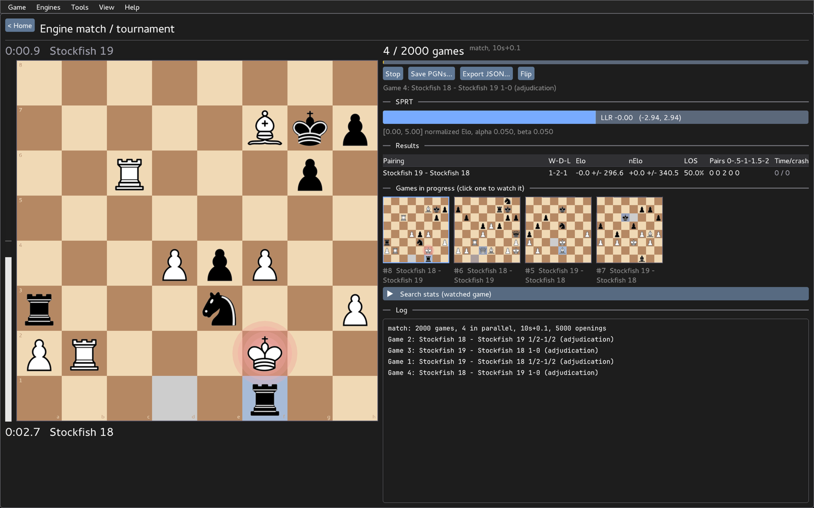
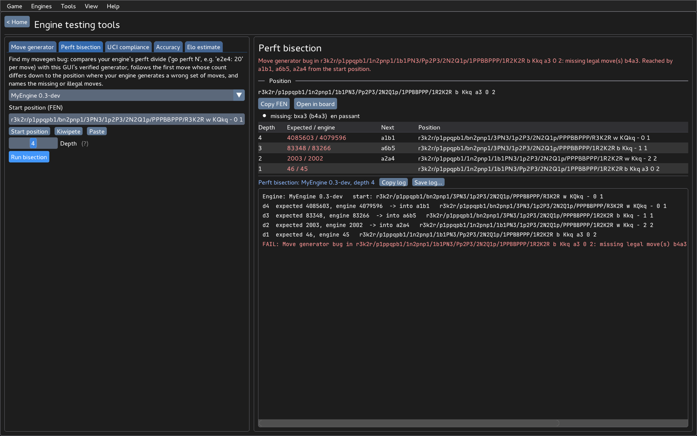
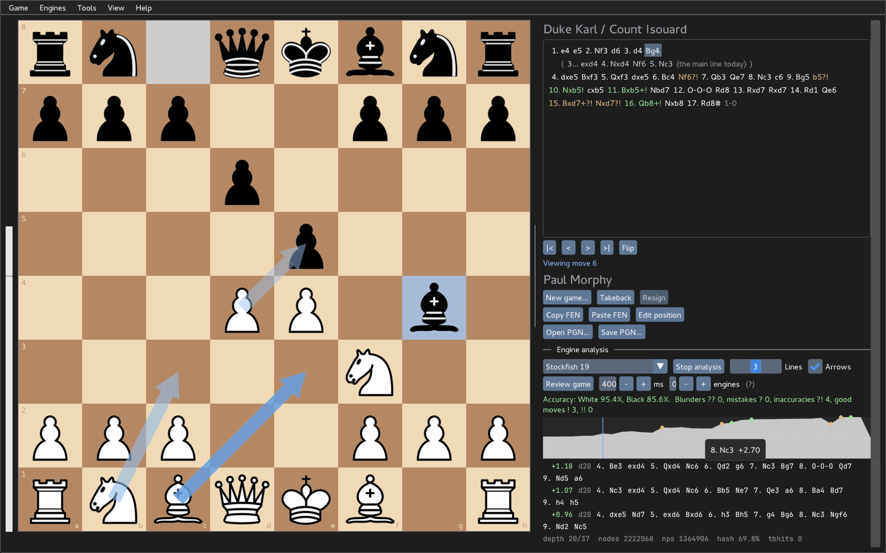

# Chess-GUI-for-UCI

**A chess GUI built for developing UCI engines: SPRT and engine matches, perft bisection,
UCI compliance checks, a command-line tool and a GitHub Action for CI, and (in preview) a
position-based Elo estimator.** It also plays, analyses and reviews games.

[](https://github.com/iman-zamani/Chess-GUI-for-UCI/actions/workflows/ci.yml)
[](https://github.com/iman-zamani/Chess-GUI-for-UCI/releases)
[](https://github.com/iman-zamani/Chess-GUI-for-UCI/releases)

GPL-2.0 · C++17 · Windows, macOS, Linux



## For engine developers

| | |
|---|---|
| **SPRT and matches** | Games in parallel, colour-swapped pairs from EPD/PGN books, match / round-robin / gauntlet, resign / draw / Syzygy adjudication, Elo and normalized Elo with 95% intervals, LOS, pentanomial counts, GSPRT with fastchess's conventions, a "dev vs base" preset, resumable runs. |
| **Perft bisection** | Your engine's `go perft` against a verified generator; on a mismatch it walks down to the position where your generator lists the wrong moves and names them. |
| **UCI compliance** | 13 protocol checks (handshake, `isready` during search, `stop`, go modes, mates, no legal moves, ponder, time management, ...) with an explanation and the engine log for each. |
| **Elo estimate** (preview) | Estimates a CCRL-Blitz-equivalent rating from test positions in minutes. The estimator is built and tested; its calibrated model is still being produced and is not included yet (see below). |
| **UCI console** | Every running engine, live, with a command line (Ctrl+U). |
| **Search statistics** | Depth, seldepth, nodes, NPS, hash and time per move, with graphs. |
| **CLI and CI** | `chess-cli` runs all of the above headless with `--json` and exit codes; a GitHub Action runs it in your engine's workflow. |
| **Chess960** | X-FEN / Shredder-FEN, `UCI_Chess960`, Chess960 matches and perft. |



## Playing and analysis

- Play against an engine or a human, with clocks, premoves and pondering.
- Analysis board: MultiPV with clickable lines, arrows, eval bar.
- Variations, comments and NAGs, with PGN import and export.
- Game review with move marks (!!, !, ?!, ?, ??), accuracy per side and an eval graph;
  the annotated game saves as PGN with `[%eval]` and NAGs.
- Board editor, board themes and piece sets (your own SVG sets too), move animation,
  sounds, resizable board, keyboard shortcuts (F1).



## How it compares

What each tool offers out of the box, as far as we know (October 2026; corrections welcome).

| | Chess-GUI-for-UCI | Arena | Cute Chess | fastchess | En Croissant |
|---|---|---|---|---|---|
| Graphical interface | yes | yes | yes | no (command line) | yes |
| Runs on Windows / macOS / Linux | all three | Windows (old Linux build) | all three | all three | all three |
| Engine games in parallel | yes | no | yes | yes | no |
| SPRT | yes (GUI and CLI) | no | yes (cutechess-cli) | yes | no |
| Engine perft check and bisection | yes | no | no | no | no |
| UCI compliance checker | yes | no | no | no | no |
| Position-based Elo estimate | preview (model not shipped yet) | no | no | no | no |
| Licence | GPL-2.0 | freeware | GPL-3.0 | MIT | GPL-3.0 |

## Quick start

Download a build from [Releases](https://github.com/iman-zamani/Chess-GUI-for-UCI/releases),
or build it ([docs/building.md](docs/building.md)):

```
cmake -B build -DCMAKE_BUILD_TYPE=Release
cmake --build build -j
./build/chess-gui
```

Then **Engines > Manage engines** to add your engine, and see the
[engine developer guide](docs/engine-developer-guide.md).

## Command line

```
chess-cli uci-check --engine cmd=./myengine
chess-cli perft --engine cmd=./myengine --depth 4
chess-cli perft-bisect --engine cmd=./myengine --fen "<FEN>" --depth 5
chess-cli sprt --engine cmd=./dev name=dev --engine cmd=./base name=base --tc 10+0.1 \
               --book book.epd --random --concurrency 4 --elo0 0 --elo1 5
chess-cli elo-estimate --engine cmd=./myengine --quick     # once a model is shipped
```

Every command takes `--json`; exit codes are non-zero when a check fails or the SPRT
accepts H0. `chess-cli help` lists all options.

## GitHub Action

```yaml
- uses: iman-zamani/Chess-GUI-for-UCI@v2.0.0
  with:
    engine: ./my-engine
    checks: uci-check,perft
```

See [docs/github-action.md](docs/github-action.md).

## The Elo estimator

An engine answers test positions at a fixed time per move; a 2PL item response model
fitted on calibration engines with known CCRL Blitz ratings turns which positions it
solves into a rating, with a 95% interval that includes the model's cross-validated
error. Quick mode is adaptive (it stops once the estimate is precise enough).

**Status:** the estimator (C++, GUI tab, `chess-cli elo-estimate`) and the calibration
pipeline (`tools/elo/`) are finished and tested, and the reference analysis of the 4600
candidate positions is done. The calibration engine runs, the cross-validation and the
model file `Resources/elo/model.json` are not done yet, so this version has no model:
the Elo tab and `chess-cli elo-estimate` say so instead of guessing. No accuracy figures
are claimed until the cross-validation exists.

Method and status: [docs/elo-estimator.md](docs/elo-estimator.md).

## Documentation

- [Engine developer guide](docs/engine-developer-guide.md): UCI checks, perft bisection, SPRT how-to
- [Elo estimator](docs/elo-estimator.md): method, protocol and status
- [GitHub Action](docs/github-action.md)
- [Building from source](docs/building.md), [Contributing](CONTRIBUTING.md), [Changelog](CHANGELOG.md)

## Licence

GPL-2.0, see [LICENSE](LICENSE). Third-party components and assets and their licences are
listed in [docs/building.md](docs/building.md) and in Help > About.
