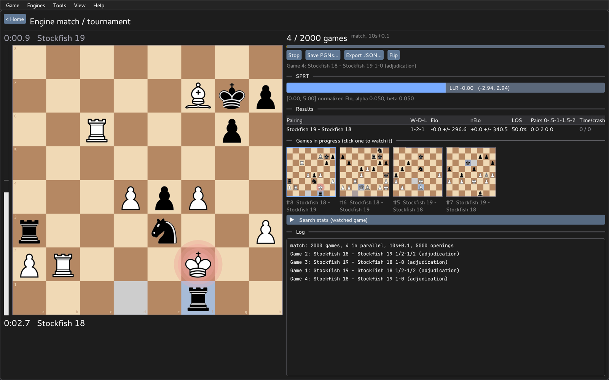
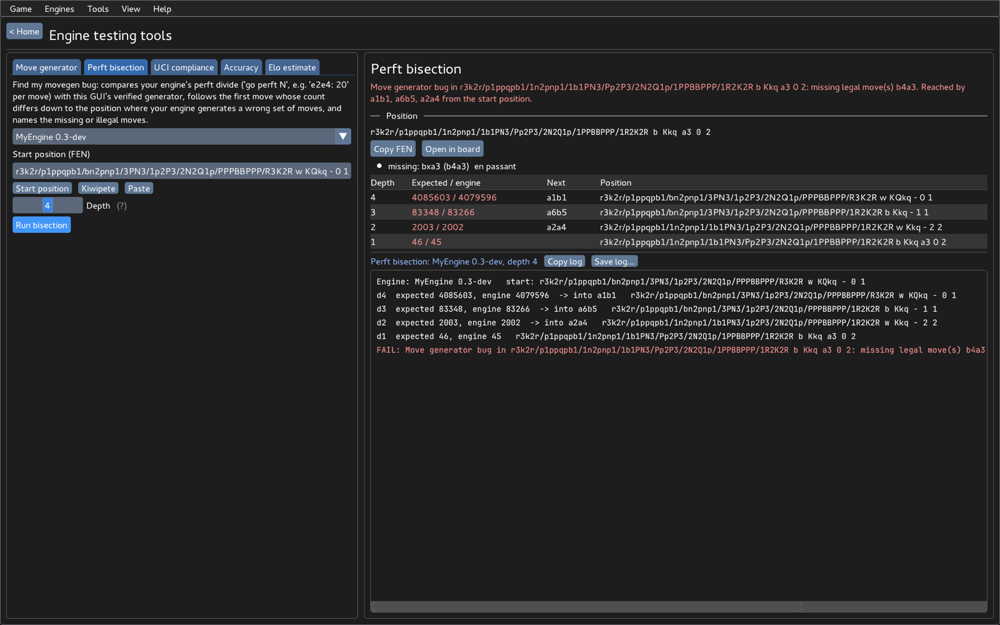
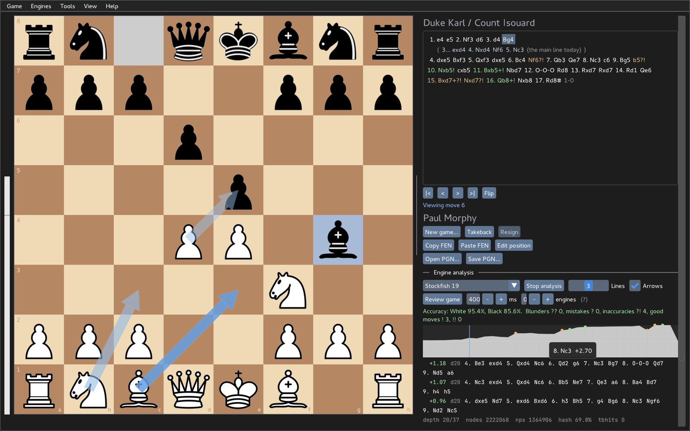

# Chess-GUI-for-UCI

**A chess GUI built for developing UCI engines: SPRT and engine matches, perft bisection,
UCI compliance checks, a command-line tool and a GitHub Action for CI, and a
position-based Elo estimator.** It also plays, analyses and reviews games.

[](https://github.com/iman-zamani/Chess-GUI-for-UCI/actions/workflows/ci.yml)
[](https://github.com/iman-zamani/Chess-GUI-for-UCI/releases)
[](https://github.com/iman-zamani/Chess-GUI-for-UCI/releases)

GPL-2.0 · C++17 · Windows, macOS, Linux



## For engine developers

| | |
|---|---|
| **SPRT and matches** | Games in parallel, colour-swapped pairs from EPD/PGN books, match / round-robin / gauntlet, resign / draw / Syzygy adjudication, Elo and normalized Elo with 95% intervals, LOS, pentanomial counts, GSPRT with fastchess's conventions, a "dev vs base" preset, resumable runs. |
| **Perft bisection** | Your engine's `go perft` against a verified generator; on a mismatch it walks down to the position where your generator lists the wrong moves and names them. |
| **UCI compliance** | 13 protocol checks (handshake, `isready` during search, `stop`, go modes, mates, no legal moves, ponder, time management, ...) with an explanation and the engine log for each. |
| **Elo estimate** | Estimates a CCRL-Blitz-equivalent rating from test positions in minutes. Cross-validated error 76 Elo (mean, whole engine family left out) for the calibration engines rated 2000-3487; much less accurate below 2000, and past 3487 it reports a bound instead of a number (see below). |
| **UCI console** | Every running engine, live, with a command line (Ctrl+U). |
| **Search statistics** | Depth, seldepth, nodes, NPS, hash and time per move, with graphs. |
| **CLI and CI** | `chess-cli` runs all of the above headless with `--json` and exit codes; a GitHub Action runs it in your engine's workflow. |
| **Chess960** | X-FEN / Shredder-FEN, `UCI_Chess960`, Chess960 matches and perft. |



## Playing and analysis

- Play against an engine or a human, with clocks, premoves and pondering.
- Analysis board: MultiPV with clickable lines, arrows, eval bar.
- Variations, comments and NAGs, with PGN import and export.
- Game review with move marks (!!, !, ?!, ?, ??), accuracy per side and an eval graph;
  the annotated game saves as PGN with `[%eval]` and NAGs.
- Board editor, board themes and piece sets (your own SVG sets too), move animation,
  sounds, resizable board, keyboard shortcuts (F1).



## How it compares

What each tool offers out of the box, as far as we know (October 2026; corrections welcome).

| | Chess-GUI-for-UCI | Arena | Cute Chess | fastchess | En Croissant |
|---|---|---|---|---|---|
| Graphical interface | yes | yes | yes | no (command line) | yes |
| Runs on Windows / macOS / Linux | all three | Windows (old Linux build) | all three | all three | all three |
| Engine games in parallel | yes | no | yes | yes | no |
| SPRT | yes (GUI and CLI) | no | yes (cutechess-cli) | yes | no |
| Engine perft check and bisection | yes | no | no | no | no |
| UCI compliance checker | yes | no | no | no | no |
| Position-based Elo estimate | yes (numbers for CCRL Blitz 1578-3487, most accurate from 2000) | no | no | no | no |
| Licence | GPL-2.0 | freeware | GPL-3.0 | MIT | GPL-3.0 |

## Quick start

Download a build from [Releases](https://github.com/iman-zamani/Chess-GUI-for-UCI/releases),
or build it ([docs/building.md](docs/building.md)):

```
cmake -B build -DCMAKE_BUILD_TYPE=Release
cmake --build build -j
./build/chess-gui
```

Then **Engines > Manage engines** to add your engine, and see the
[engine developer guide](docs/engine-developer-guide.md).

**macOS, first launch:** the app is not notarized (that needs a paid Apple Developer ID),
so macOS says Apple could not verify it. Click **Done**, then open **System Settings >
Privacy & Security** and click **Open Anyway** next to "Chess GUI for UCI". This is needed
once. From a terminal, `xattr -dr com.apple.quarantine "/Applications/Chess GUI for UCI.app"`
does the same (for `chess-cli`, run it on the `chess-cli` folder).

## Command line

```
chess-cli uci-check --engine cmd=./myengine
chess-cli perft --engine cmd=./myengine --depth 4
chess-cli perft-bisect --engine cmd=./myengine --fen "<FEN>" --depth 5
chess-cli sprt --engine cmd=./dev name=dev --engine cmd=./base name=base --tc 10+0.1 \
               --book book.epd --random --concurrency 4 --elo0 0 --elo1 5
chess-cli elo-estimate --engine cmd=./myengine --quick     # once a model is shipped
```

Every command takes `--json`; exit codes are non-zero when a check fails or the SPRT
accepts H0. `chess-cli help` lists all options.

## GitHub Action

```yaml
- uses: iman-zamani/Chess-GUI-for-UCI@v1.1.1
  with:
    engine: ./my-engine
    checks: uci-check,perft
```

See [docs/github-action.md](docs/github-action.md).

## The Elo estimator

An engine answers test positions at a fixed time per move; a 2PL item response model
fitted on calibration engines with known CCRL Blitz ratings turns which positions it
solves into a rating, with a 95% interval that includes the model's cross-validated
error. Quick mode is adaptive (it stops once the estimate is precise enough).

The engine gets the same amount of search as the calibration engines did: before the test, two
reference engines that ship with the program (Stockfish 11 and Blunder 8.0.0) repeat searches
recorded on the calibration machine, which measures how fast this computer runs engines; the
move time is set from that. Every minute during the test and after it, the reference engines
repeat some of those searches and your engine repeats one fixed search of its own, to catch a
change of speed (throttling, other load). On Linux and Windows every engine is pinned to one
core of the fastest class (a P-core on hybrid CPUs); on Apple silicon the share of its time on
performance cores is measured. A run where the speed changed, or where the engine didn't use its
time, used more than one thread, busy-waited for input or made illegal moves, gets a warning or
no number at all.

**Accuracy** (cross-validation on 32 calibration engines from 9 families, CCRL Blitz
1271-3563; every fold refits and reselects the positions without the engines it predicts):

| CCRL Blitz | engines | error, engine left out (MAE) | error, whole family left out (MAE) |
|---|---|---|---|
| 2500 and above | 18 | 76 | 81 |
| 2000-2500 | 6 | 55 | 55 |
| below 2000 | 8 | 174 | 249 |

Estimates are numbers only inside the calibrated range, 1578-3487. An estimate past either end
is a bound instead: "above the calibrated range: at least 3487" for Stockfish 16 or 19, or, when
the interval still reaches into the range, its lower end: "past the top of the calibrated range
(3487): at least 3368" for Ethereal 14 (CCRL Blitz 3647).
Engines much stronger than about 3600 solve almost every position, so the positions can't
tell them apart. Below 2000 the estimate tends to be too high for an engine whose family the
model has not seen, and a warning is printed. Engines kept out of every fit and then
estimated with the shipped model on the calibration machine (Linux) and an Apple M4: all 34
runs correct. Fatalii 0.2.0-0.5.0 (CCRL Blitz 1599-2208), Weiss 1.0-2.0 (2896-3319) and
Berserk 3.2.0 (2910) got numbers within 147 Elo, mean 54, each inside its 95% interval;
Koivisto, Obsidian, Seer, PlentyChess, Stockfish 16 and Ethereal 14 (3632-3774) got bounds
(their solve rates also set the ceiling, so that is a consistency check). On GitHub's
Linux, Windows and macOS runners, Weiss, Fatalii and Berserk 3.2.0 (built there) were inside
their intervals in all 14 runs that gave a number.
It is an estimate from positions, not a rating from games; time management is not measured.

Method, full results and limits: [docs/elo-estimator.md](docs/elo-estimator.md).

## Documentation

- [Engine developer guide](docs/engine-developer-guide.md): UCI checks, perft bisection, SPRT how-to
- [Elo estimator](docs/elo-estimator.md): method, protocol and accuracy
- [GitHub Action](docs/github-action.md)
- [Building from source](docs/building.md), [Contributing](CONTRIBUTING.md), [Changelog](CHANGELOG.md)

## Licence

GPL-2.0, see [LICENSE](LICENSE). Third-party components and assets and their licences are
listed in [docs/building.md](docs/building.md) and in Help > About.
